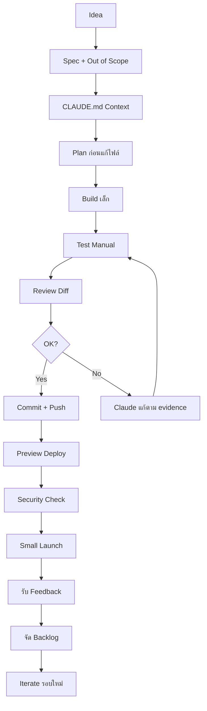
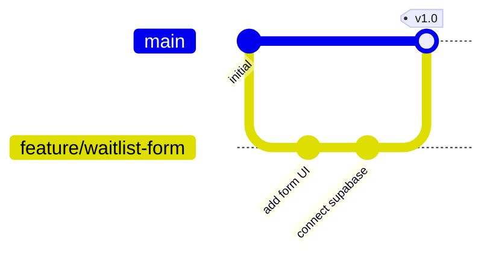

ตามที่คุณขอ ผมได้สังเคราะห์เนื้อหาจากหนังสือ **“Vibe Coding สำหรับ non-coders”** และจัดทำเป็นเอกสารคู่มือฉบับสมบูรณ์ ครอบคลุมหัวข้อที่กำหนด ทั้งส่วนที่เป็นแนวคิดเชิงระบบ (Workflow, Dataflow, RCA, Git Flow) และส่วนที่ปฏิบัติได้จริง (Code Templates, Checklists, Security, CI/CD) โดยปรับให้เหมาะกับผู้ที่ไม่ใช่โปรแกรมเมอร์ (Non-coder) ที่ใช้ **Claude Code** เป็นเครื่องมือหลัก

---

# คู่มือการพัฒนาแอปพลิเคชันด้วย Vibe Coding (Claude Code) สำหรับ Non‑Coder

## สารบัญ
1. บทนำ  
2. บทนิยาม  
3. โครงสร้างโฟลเดอร์  
4. หลักการทำงาน (Concept)  
5. Workflow และ Dataflow  
   - 5.1 Workflow การพัฒนาทั้งเล่ม  
   - 5.2 Dataflow สำหรับ Waitlist App (ตัวอย่าง)  
6. Code เทมเพลตและตัวอย่างโค้ด  
   - 6.1 Landing Page + Waitlist Form  
   - 6.2 Supabase Integration  
   - 6.3 Internal Dashboard (อ่านอย่างเดียว)  
7. Checklist – Module การทำงาน  
8. Security Code – แนวทางปฏิบัติ  
9. Load Test Development (แนวทางสำหรับ Non‑Coder)  
10. สรุป  
    - ประโยชน์ที่ได้รับ  
    - ข้อควรระวัง  
    - ข้อดี / ข้อเสีย  
    - ข้อห้าม  
    - ตัวอย่างโค้ดที่รันได้จริง  
11. คู่มือการทดสอบ (Test Guide)  
12. คู่มือการใช้งาน (User Guide)  
13. คู่มือการบำรุงรักษา (Maintenance Guide)  
14. คู่มือการขยาย/แก้ไข (Extension Guide)  
    - 14.1 Git Flow สำหรับ Non‑Coder  
    - 14.2 Code Review และ Pull Request  
    - 14.3 CI/CD อย่างง่ายด้วย Vercel  
15. Root Cause Solution (RCA) – ขั้นตอนการวิเคราะห์สาเหตุที่แท้จริง  

---

## 1. บทนำ
**Vibe Coding** คือกระบวนการที่ **Non‑Coder** ใช้ AI Coding Agent (ในที่นี้คือ Claude Code) เพื่อสร้างเว็บแอปพลิเคชันจริง โดยไม่ต้องเขียนโค้ดเองทุกบรรทัด บทบาทของคุณไม่ใช่โปรแกรมเมอร์ แต่คือ **AI Product Director** ที่กำหนด **Scope, Spec, Context, การทดสอบ และความปลอดภัย** คู่มือนี้จะเปลี่ยนหนังสือกว่า 300 หน้าให้เป็นโครงสร้างระบบที่นำไปใช้งานได้ทันที พร้อมตัวอย่างโค้ดและกระบวนการที่ตรวจสอบได้

## 2. บทนิยาม (เฉพาะที่ใช้บ่อย)
| ศัพท์ | ความหมาย (แบบคนทั่วไป) |
|------|--------------------------|
| Claude Code | AI agent ที่อ่านและแก้ไขไฟล์โปรเจกต์จริง, รันคำสั่ง terminal ได้ |
| Spec | เอกสารสั้น ๆ บอกว่า version แรกจะทำอะไร / ไม่ทำอะไร |
| CLAUDE.md | ไฟล์บริบทประจำโปรเจกต์ (Context) – ให้ Claude อ่านทุกครั้ง |
| Diff | รายการเปลี่ยนแปลงไฟล์ ตรวจก่อน commit |
| RLS (Row Level Security) | กฎในฐานข้อมูล ว่าใครดู/เพิ่ม/แก้/ลบ แถวไหนได้บ้าง |
| Preview Deployment | URL ทดสอบที่สร้างจาก branch/PR ก่อนขึ้น production |
| Rollback | ย้อน production กลับไปใช้เวอร์ชันก่อนหน้า |

> คำศัพท์เพิ่มเติมดูได้ที่ Glossary ในหนังสือ บทที่ 0

## 3. โครงสร้างโฟลเดอร์ (แนะนำสำหรับโปรเจกต์เล็ก)
```
my-project/
├── CLAUDE.md               # บริบทประจำโปรเจกต์ (AI อ่าน)
├── README.md               # อ่านโดยมนุษย์
├── .env.example            # ตัวอย่าง environment variables (ไม่มีค่าจริง)
├── .gitignore              # ป้องกัน commit ไฟล์ลับ
├── index.html (หรือ app หลัก)
├── docs/
│   ├── QA_CHECKLIST.md
│   ├── SECURITY_CHECKLIST.md
│   ├── HANDOFF.md
│   └── DECISIONS.md
└── (โค้ดอื่น ๆ ตาม framework)
```
> สำหรับโปรเจกต์ Landing Page ธรรมดา ไม่ต้องมี `docs/` ย่อยก็ได้

## 4. หลักการทำงาน (Concept)
1. **AI ลงมือเขียนโค้ด** – Claude Code สร้าง/แก้ไขไฟล์, รันคำสั่ง  
2. **คุณเป็นผู้กำกับ** – ตัดสินใจ Scope, Spec, ดู Diff, ทดสอบ, ตรวจสอบความปลอดภัย  
3. **Iteration สั้น** – เล็ก → ทดสอบ → แก้ → Deploy → รับ Feedback  
4. **ความปลอดภัยไม่ใช่ตัวเลือก** – ต้องตรวจ RLS, Secret, Environment Variables ทุกครั้ง  
5. **Rollback ได้เสมอ** – ใช้ Git + Vercel Instant Rollback เป็นเซฟตี้เน็ต  

## 5. Workflow และ Dataflow

### 5.1 Workflow การพัฒนาทั้งเล่ม (นำมาจากหนังสือ บทที่ 1-11)


### 5.2 Dataflow สำหรับ Waitlist App (ตัวอย่างจากบทที่ 7)
```mermaid
flowchart LR
U[User กรอกฟอร์ม] --> F[Frontend (React/Next.js)]
F -->|publishable key + RLS| S[Supabase API]
S --> T[(Table waitlist_leads)]
T --> D[Supabase Dashboard (ดูข้อมูล)]
F -->|แสดง| M[Success/Error Message]

style S fill:#f9f,stroke:#333,stroke-width:2px
style T fill:#bbf,stroke:#333
```
**คำอธิบายแบบละเอียด**  
- User กรอก `name, email, use_case` ที่หน้า Landing Page  
- Frontend ใช้ **publishable key** (ไม่ใช่ secret key) ส่ง `INSERT` ไปยัง Supabase  
- Supabase เปิด **RLS** ไว้ โดย policy อนุญาตให้ **public insert** แต่ไม่อนุญาต **select/update/delete**  
- เมื่อ insert สำเร็จ Frontend แสดงข้อความขอบคุณ  
- เจ้าของโปรเจกต์ดูข้อมูลผ่าน **Supabase Dashboard** หรือ **Internal Dashboard** ที่มี Authentication เท่านั้น  

## 6. Code เทมเพลตและตัวอย่างโค้ด

### 6.1 Landing Page + Waitlist Form (HTML + JavaScript + Supabase)
```html
<!-- index.html -->
<!DOCTYPE html>
<html lang="th">
<head>
    <meta charset="UTF-8">
    <meta name="viewport" content="width=device-width, initial-scale=1.0">
    <title>AI Workflow Audit</title>
    <style>
        body { font-family: sans-serif; max-width: 600px; margin: 2rem auto; padding: 1rem; }
        input, textarea { width: 100%; margin: 0.5rem 0; padding: 0.5rem; }
        button { background: #2563eb; color: white; padding: 0.75rem; border: none; cursor: pointer; }
        .error { color: red; }
        .success { color: green; }
    </style>
</head>
<body>
    <h1>จองคิวปรึกษา AI Workflow Audit</h1>
    <form id="waitlistForm">
        <input type="text" id="name" placeholder="ชื่อ" required>
        <input type="email" id="email" placeholder="อีเมล" required>
        <textarea id="use_case" placeholder="ปัญหาที่อยากแก้ (ถ้ามี)"></textarea>
        <button type="submit">ส่งข้อมูล</button>
    </form>
    <div id="message"></div>

    <script src="https://cdn.jsdelivr.net/npm/@supabase/supabase-js@2"></script>
    <script>
        // กำหนด ENV Vars (ใช้ค่าจาก .env.local หรือ hardcode ชั่วคราว - ไม่แนะนำ)
        const SUPABASE_URL = 'https://your-project.supabase.co';   // change this
        const SUPABASE_PUBLISHABLE_KEY = 'your-publishable-key';   // change this

        const supabase = window.supabase.createClient(SUPABASE_URL, SUPABASE_PUBLISHABLE_KEY);

        const form = document.getElementById('waitlistForm');
        const messageDiv = document.getElementById('message');

        form.addEventListener('submit', async (e) => {
            e.preventDefault();
            const name = document.getElementById('name').value;
            const email = document.getElementById('email').value;
            const use_case = document.getElementById('use_case').value;

            // Basic validation
            if (!name || !email) {
                messageDiv.innerHTML = '<p class="error">กรุณากรอกชื่อและอีเมล</p>';
                return;
            }
            if (!email.includes('@')) {
                messageDiv.innerHTML = '<p class="error">รูปแบบอีเมลไม่ถูกต้อง</p>';
                return;
            }

            // Insert into Supabase
            const { error } = await supabase
                .from('waitlist_leads')
                .insert([{ name, email, use_case }]);

            if (error) {
                console.error('Supabase insert error:', error);
                if (error.code === '23505') { // unique violation
                    messageDiv.innerHTML = '<p class="error">อีเมลนี้ลงทะเบียนไว้แล้ว</p>';
                } else {
                    messageDiv.innerHTML = '<p class="error">เกิดข้อผิดพลาด กรุณาลองใหม่</p>';
                }
            } else {
                messageDiv.innerHTML = '<p class="success">ขอบคุณที่ลงทะเบียน! เราจะติดต่อกลับ</p>';
                form.reset();
            }
        });
    </script>
</body>
</html>
```

### 6.2 การสร้างตารางและ RLS (SQL – รันใน Supabase SQL Editor)
```sql
-- สร้างตาราง waitlist_leads (Thai/English comments)
-- Create table for waitlist submissions
CREATE TABLE IF NOT EXISTS public.waitlist_leads (
    id BIGINT GENERATED ALWAYS AS IDENTITY PRIMARY KEY,
    email TEXT NOT NULL,
    name TEXT,
    use_case TEXT,
    created_at TIMESTAMPTZ NOT NULL DEFAULT now()
);

-- ป้องกันอีเมลซ้ำ (prevent duplicate emails)
CREATE UNIQUE INDEX IF NOT EXISTS waitlist_leads_email_unique 
ON public.waitlist_leads (email);

-- เปิด RLS (Enable Row Level Security)
ALTER TABLE public.waitlist_leads ENABLE ROW LEVEL SECURITY;

-- อนุญาตให้ public (anon) insert เท่านั้น
-- Allow public to insert only
GRANT INSERT ON public.waitlist_leads TO anon;

-- Policy: ให้ insert ได้ ถ้ามีอีเมลไม่เกิน 320 ตัวอักษร
-- Policy: allow insert if email is not null and short
CREATE POLICY "Public can submit waitlist"
ON public.waitlist_leads
FOR INSERT
TO anon
WITH CHECK (
    email IS NOT NULL 
    AND LENGTH(email) <= 320
);

-- ไม่มี SELECT/UPDATE/DELETE policy => anon จะอ่านข้อมูลไม่ได้ (important!)
```

### 6.3 Internal Dashboard อย่างง่าย (อ่านข้อมูลเฉพาะ authenticated user)
```html
<!-- admin.html (ต้องมีการ login ด้วย Supabase Auth) -->
<script>
    // ใช้ same Supabase client + session
    const { data: { session } } = await supabase.auth.getSession();
    if (!session) window.location.href = '/login.html';

    // ดึงข้อมูล leads (ต้องมี policy ให้ authenticated user SELECT)
    const { data, error } = await supabase
        .from('waitlist_leads')
        .select('name, email, use_case, created_at')
        .order('created_at', { ascending: false });
    
    if (error) console.error(error);
    else renderTable(data);
</script>
```
> **ข้อควรระวัง** ต้องมี RLS policy สำหรับ `authenticated` role ที่อนุญาต SELECT ด้วย

## 7. Checklist – Module การทำงาน (ใช้ก่อนเรียกงานว่าเสร็จ)
- [ ] Spec ระบุชัดเจน (Goal, Scope, Out of scope)  
- [ ] CLAUDE.md มีอยู่และอัปเดต  
- [ ] Claude เสนอ Plan ก่อนแก้ไฟล์  
- [ ] เปลี่ยนแปลงเฉพาะไฟล์ที่เกี่ยวข้อง (review diff)  
- [ ] Manual test ผ่าน: Happy Path + Edge cases (email ซ้ำ, ค่าว่าง)  
- [ ] ไม่มี secret / .env ถูก commit  
- [ ] RLS เปิด และ policy ถูกต้อง  
- [ ] Deploy บน Preview แล้วทดสอบ  
- [ ] Production test หลัง deploy  
- [ ] มี Launch note หรือ Release note  

## 8. Security Code – แนวทางปฏิบัติ (จากบทที่ 10)
| กฎ | รายละเอียด |
|-----|-------------|
| 1. อย่า Blind Trust | ตรวจทุกอย่างที่ AI สร้าง |
| 2. Data minimization | เก็บเฉพาะข้อมูลที่จำเป็น |
| 3. ใช้ Publishable Key | ห้ามใช้ Service Role Key ใน Frontend |
| 4. RLS เสมอ | เปิด RLS ทุก table ที่ exposed |
| 5. Input validation | ทั้งฝั่ง client และ database (with check) |
| 6. แยก Environment | local, preview, production ใช้ env vars ต่างกัน |
| 7. Log อย่างปลอดภัย | ห้าม log secret, password, token |
| 8. Owner & Asset | รู้ว่าใครเป็นเจ้าของ app, rotate key เป็นระยะ |

## 9. Load Test Development (แนวทางสำหรับ Non‑Coder)
เนื่องจาก Non‑Coder ไม่ควรทำ load test เต็มรูปแบบด้วยตัวเอง ให้ใช้วิธีง่าย ๆ ดังนี้  
1. **ทดสอบด้วยตนเอง** – ส่งฟอร์มซ้ำ ๆ 10-20 ครั้ง ดูว่า database ตอบสนองอย่างไร  
2. **ใช้ Supabase ปริมาณฟรี** – ปกติพอสำหรับโปรเจกต์เริ่มต้น  
3. **ใช้บริการฟรี** – เช่น [K6](https://k6.io) หรือ [Postman collection](https://www.postman.com) แต่อาจต้องให้ dev ช่วยตั้งค่า  
4. **สังเกต Vercel Function Timeout** – ถ้ามี Serverless function ให้ดู logs ว่ามี timeout หรือ rate limit หรือไม่  
5. **ถ้าจำเป็นต้องโหลดจริง** – ให้ส่งต่อไปยัง developer หรือใช้เครื่องมือที่ AI เขียนสคริปต์ทดสอบให้ แล้วค่อยๆ รัน  

> **คำแนะนำ** สำหรับ MVP หรือ prototype ยังไม่จำเป็นต้อง load test จนกว่าจะมีผู้ใช้จริง > 100 คน

## 10. สรุป

### ประโยชน์ที่ได้รับ
- สร้างเว็บแอปจริงได้ โดยไม่ต้องเรียนเขียนโค้ดหลายเดือน  
- ลดเวลาในการทดสอบไอเดีย (จากไอเดีย → ของที่ deploy ได้)  
- เรียนรู้บทบาทของ Product Owner / AI Product Director  

### ข้อควรระวัง
- อย่าไว้ใจ AI 100% – ต้อง review diff, ทดสอบ manual และเช็ค security  
- อย่าเก็บข้อมูลสำคัญโดยไม่เข้าใจ RLS และ permission  
- อย่า deploy dashboard ที่ไม่มี authentication สู่สาธารณะ  

### ข้อดี / ข้อเสีย
| ข้อดี | ข้อเสีย |
|-------|---------|
| รวดเร็ว, ต้นทุนเริ่มต้นต่ำ | ความเสี่ยงด้าน security สูงถ้าไม่ตรวจ |
| Non‑coder มีอำนาจสร้างของจริง | ยังต้องเข้าใจ concept (env, RLS, deploy) |
| Iteration ได้เร็วตาม feedback | Scaling และ load test ต้องอาศัยผู้ชำนาญ |

### ข้อห้าม (Do’s and Don’ts)
| ห้าม (Don’ts) | คำอธิบาย |
|---------------|-----------|
| ห้าม commit .env หรือ .env.local | เพราะ secret จะรั่ว |
| ห้ามใช้ service_role key ใน browser | ใครก็เอาไปใช้สิทธิ์สูงได้ |
| ห้ามปิด RLS เพื่อให้สะดวก | ข้อมูลจะเปิดเผย |
| ห้าม deploy dashboard โดยไม่มี auth | คนอื่นอาจเห็นข้อมูลลูกค้า |
| ห้ามบอกว่า “มันพัง แก้หน่อย” โดยไม่มี evidence | AI จะเดาและเสียเวลา |

### ตัวอย่างโค้ดที่รันได้จริง
ดูข้อ 6.1 และ 6.2 – สามารถนำ `index.html` ไปวางในโฟลเดอร์ เปิดด้วย Live Server หรือ deploy ขึ้น Vercel ได้ทันที (ต้องตั้งค่า Supabase URL + key)

## 11. คู่มือการทดสอบ (Test Guide) – สำหรับ Non‑Coder
**Checklist ทดสอบก่อนเปิดให้คนอื่นใช้**
- [ ] **Smoke test** – หน้าโหลดได้, ไม่มี error ใน console  
- [ ] **Mobile** – เปิดบนมือถือ, responsive, ปุ่มกดง่าย  
- [ ] **Form validation** – email ว่าง/ผิดรูปแบบ → แสดง error  
- [ ] **Success/Failure** – ส่งสำเร็จแสดงข้อความขอบคุณ, ส่งไม่สำเร็จแจ้ง error ที่เข้าใจ  
- [ ] **Security** – ไม่มี secret key แสดงในหน้าเว็บ, ไม่มีข้อมูลผู้ใช้คนอื่นแสดง  
- [ ] **Database** – ตรวจสอบว่า row ถูก insert จริง (ผ่าน Supabase Dashboard)  
- [ ] **Production URL** – ทดสอบซ้ำบน production (ไม่ใช่แค่ local)  

## 12. คู่มือการใช้งาน (User Guide สำหรับผู้ดูแล)
1. **เริ่มต้น** – clone repo, `npm install` (ถ้ามี), ตั้งค่า `.env.local`  
2. **รัน local** – `npm run dev` (หรือเปิด index.html โดยตรง)  
3. **แก้ไขเนื้อหา** – แก้ `index.html` หรือ component ที่ Claude สร้างให้  
4. **deploy** – push ขึ้น GitHub → Vercel จะ auto deploy (production branch = main)  
5. **ดู lead** – เข้า Supabase Dashboard → Table `waitlist_leads`  
6. **Rollback** – กรณี production พัง → Vercel → Deployment → Instant Rollback  

## 13. คู่มือการบำรุงรักษา (Maintenance Guide) – รายเดือน
- [ ] ตรวจสอบว่า RLS ยังเปิดอยู่และ policy ยังถูกต้อง  
- [ ] ดู Vercel analytics / Supabase logs ว่ามี error ผิดปกติไหม  
- [ ] อัปเดต dependencies (ถ้ามี `package.json`) – ให้ Claude ช่วย `npm outdated` และเสนอ upgrade  
- [ ] ตรวจสอบว่าไม่มี secret หลุดใน GitHub (ใช้ Secret Scanning)  
- [ ] ถ้าเก็บข้อมูลผู้ใช้, ตรวจสอบตาม PDPA/GDPR (เช่น มีปุ่มลบข้อมูลหรือไม่)  
- [ ] ทดสอบ manual flow หลักอีกครั้ง (ป้องกัน regression)  

## 14. คู่มือการขยาย/แก้ไข (Extension Guide)

### 14.1 Git Flow สำหรับ Non‑Coder (อย่างง่าย)

- **branch หลัก**: `main` (production)  
- **branch feature**: `feature/ชื่องาน`  
- **งานทุกชิ้น** ควรผ่าน Pull Request (PR) และ Preview Deployment ก่อน merge  

### 14.2 Code Review และ Pull Request (บทที่ 11 + Appendix G)
**Checklist สำหรับ PR**
- [ ] change ตรงตาม scope ที่กำหนด  
- [ ] diff ไม่มีไฟล์นอก scope หรือ .env  
- [ ] preview URL ผ่านการทดสอบ  
- [ ] ไม่มี issue ด้านความปลอดภัย (secret, RLS)  
- [ ] merge แล้ว production smoke test ผ่าน  

**ตัวอย่างชื่อ PR**: `feat: add waitlist success state`

### 14.3 CI/CD อย่างง่ายด้วย Vercel
- Vercel ผูกกับ GitHub → เมื่อ push ไป `main` จะ deploy production อัตโนมัติ  
- เมื่อเปิด PR → Vercel สร้าง **Preview Deployment** ให้ทดสอบก่อน  
- ถ้า production พัง → ใช้ **Instant Rollback** ใน Vercel dashboard  

## 15. Root Cause Solution (RCA) – ขั้นตอนการวิเคราะห์สาเหตุที่แท้จริง
นำแนวทางจากหนังสือ (บทที่ 9 + Appendix F) มาเป็นกระบวนการ

### ขั้นตอนการทำ RCA
1. **ระบุปัญหา** (Define the Problem)  
   - เกิดอะไรขึ้น? (เช่น “ส่งฟอร์ม waitlist แล้วไม่เห็นข้อมูลใน Supabase”)  
   - ควรเกิดอะไร? (ควรมี row ใหม่ในตาราง)

2. **รวบรวมข้อมูล** (Collect Data) – ใช้ **Evidence Template**  
   - Browser console error, Network tab (status, response)  
   - Terminal log / Vercel build log  
   - Supabase error message, RLS policy ปัจจุบัน  
   - การเปลี่ยนแปลงล่าสุด (commits, env var ที่เปลี่ยน)

3. **ระบุสาเหตุที่เป็นไปได้** (Identify Possible Causes)  
   - Environment variables ขาด / ผิด (local vs production)  
   - RLS policy ไม่อนุญาต insert  
   - Table name / column ไม่ตรง  
   - Validation ฝั่ง frontend หรือ database ป้องกัน  
   - duplicate email constraint  

4. **หา “สาเหตุหลัก”** (Find the Root Cause)  
   - ทดสอบทีละข้อ: ตรวจ env var → ตรวจ RLS → ตรวจ network request → ดู log  
   - ถ้าสามารถลดขั้นตอนการทดสอบให้สั้นที่สุดและ reproduce ได้ชัดเจน นั่นคือ root cause  

5. **วางแผนและแก้ไข** (Implement Solution)  
   - ใช้ Claude Code ช่วยแก้ โดยให้ evidence และ scope ที่จำกัด  
   - แก้ทีละจุด (แก้เฉพาะ root cause)  
   - ทดสอบซ้ำทันที  

6. **ติดตามผล** (Monitor)  
   - หลังแก้ไข ให้ deploy ขึ้น preview/production แล้วทดสอบซ้ำ  
   - ถ้าปัญหาไม่กลับมา ให้บันทึกบทเรียน (Decision Log)  
   - ถ้ากลับมา แสดงว่ายังไม่ใช่ root cause หรือมีสาเหตุอื่นร่วม  

**ตัวอย่าง RCA สั้น ๆ**  
> Problem: Production form submit error 500  
> Evidence: Vercel log แสดง “SupAuthError: no permission to insert”  
> Possible causes: RLS policy เปิด แต่ environment ใช้ anon key ผิด project  
> Root cause: Vercel env `NEXT_PUBLIC_SUPABASE_URL` ชี้ไปยัง project เก่า  
> Fix: แก้ URL ใน Vercel Environment Variables → redeploy → issue resolved.

---

**จบคู่มือ** – เอกสารนี้สามารถใช้เป็นแนวทางปฏิบัติสำหรับ Non‑Coder ที่จะพัฒนาแอปพลิเคชันด้วย Claude Code โดยยึดหลัก **AI ช่วยลงมือ แต่คุณเป็นผู้กำกับความปลอดภัยและคุณภาพ** หากต้องการรายละเอียดเพิ่มเติม (เช่น prompt templates, ตัวอย่าง SQL เพิ่ม, การตั้งค่า GitHub PR อัตโนมัติ) สามารถเปิด Appendix ตามที่หนังสืออ้างอิงได้ทันที