# Thaibev Technology Stack

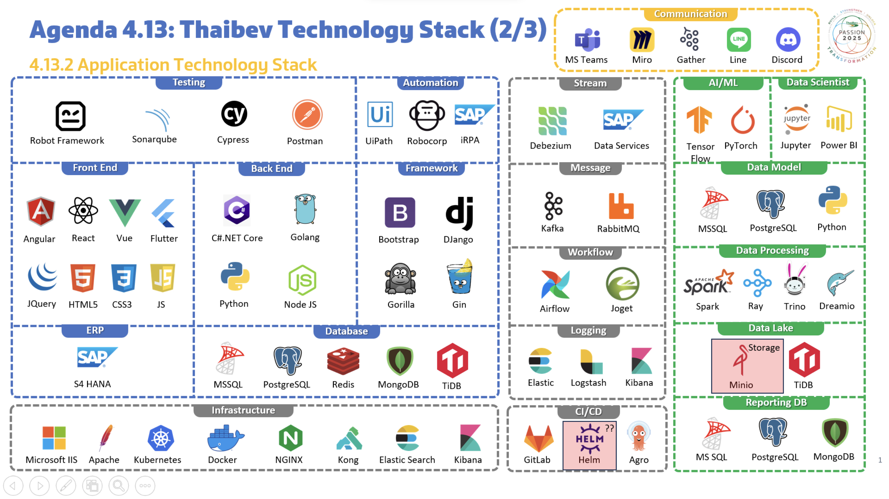

# k3s+Gitlab on Private Cloud 
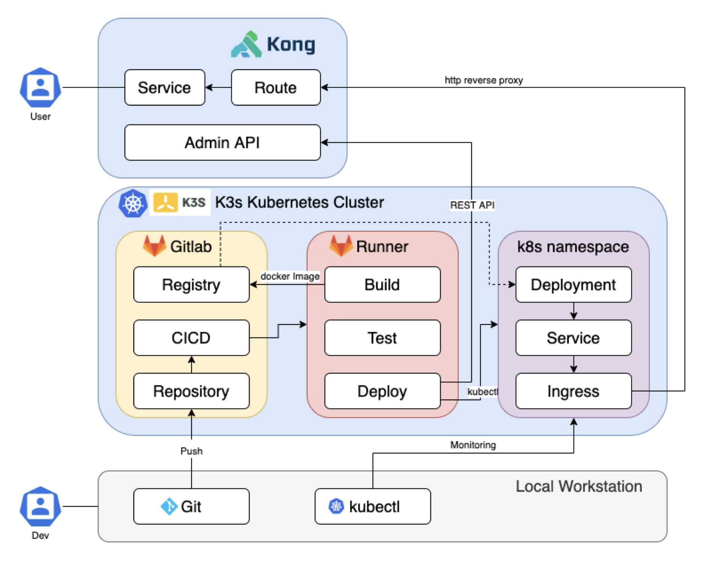

# Container principle
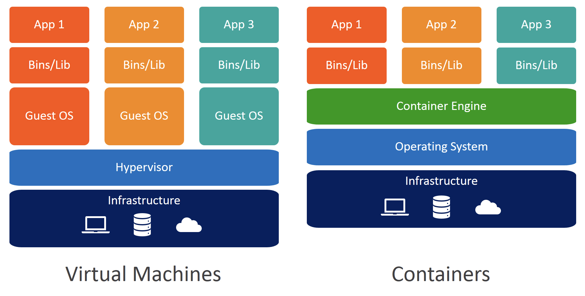
- With VM (hypervisor)+ A full visualized system monopolizes its own set of resources allocated to it + Minimal sharing+ You get more isolation, resource isolation+ It is much heavier, fix resource allocation+ Full install OS, Drivers, Libraries
- With Container + Less isolation, libs can be shared + Containers are lightweight, less resource requirement + Require fewer resources, mean you can run in large quantities + It can easily run thousands of containers on a host, user won’t even feel the drag

# What & Why is  Kubernetes 
Why would you want to use Kubernetes?
To avoid versioning problems — to run versions of operating systems, programming languages, database apps, web apps and web servers, machine learning programs — all in isolated environments
It’s Portable, you can use the same image everywhere inside Docker and Kubernetes environment
No software conflict, isolated environment always works.
Scaling can be done easily and on demand
    - Advantages over VM
    - Auto scaling
    - Replicas
    - Storage Management
    - Resource Management
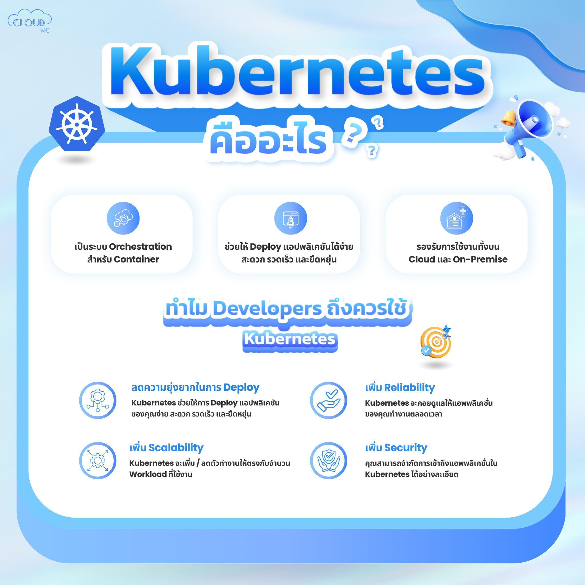
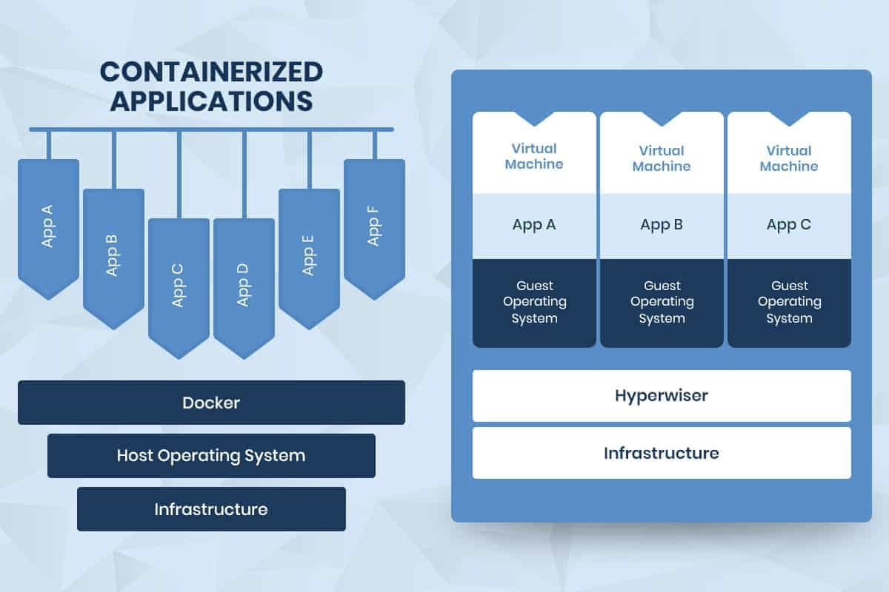

# Why, What is  Gitlab (version-control system)What is CI/CD
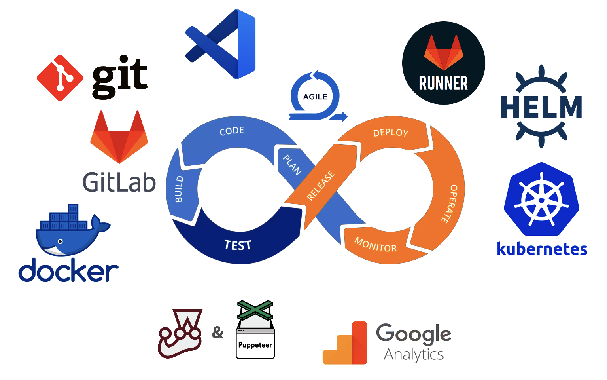
- Continuous Integration ( Flow , Automation on Branch, Merge Code, Pull Request )
- Continuous Deployment ( Deploy, Drop artefact, Run exe, Run Command )

# Gitlab CICD Configuration ( gitlab-ci.yml )
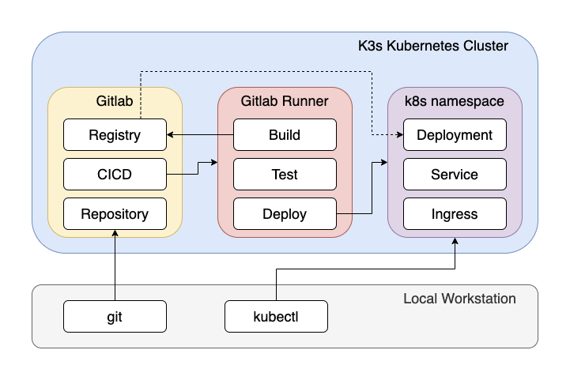

# Gitlab + Gitlab Runner
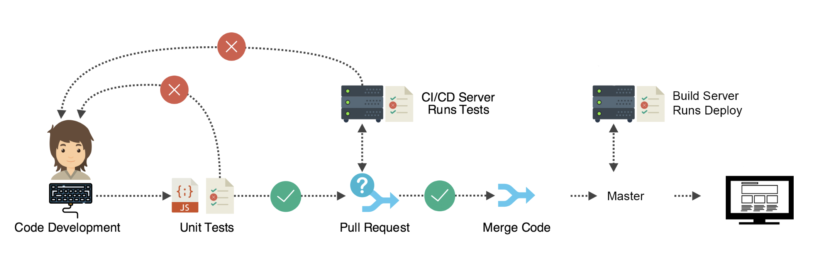
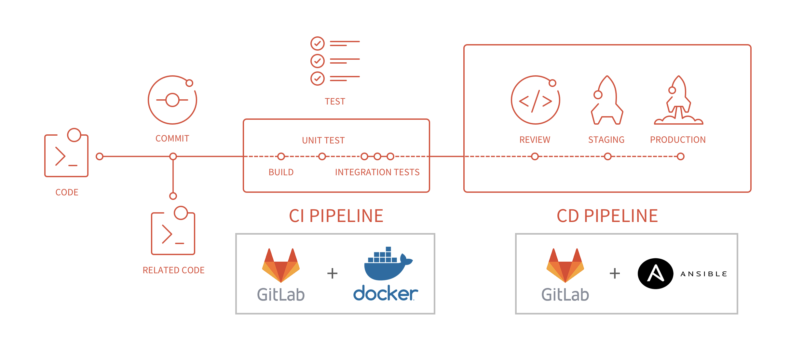
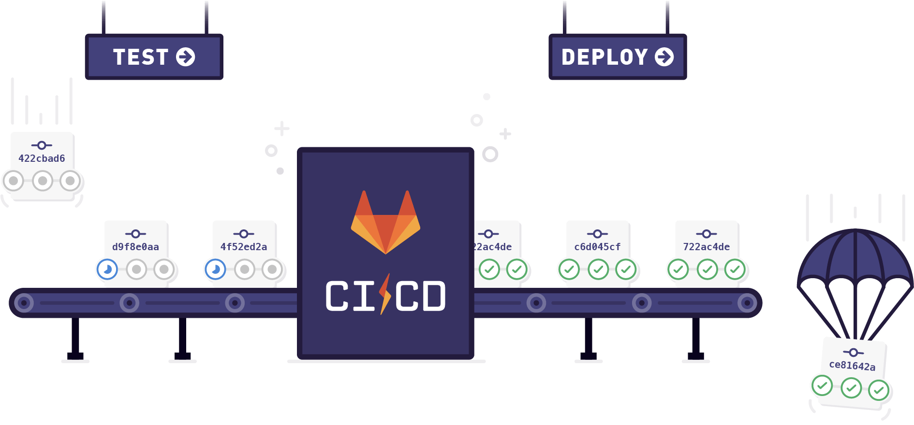
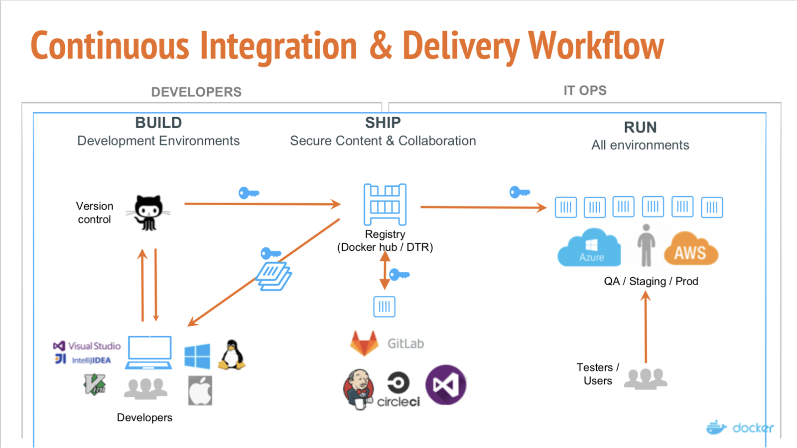

# Build & Dockerfile
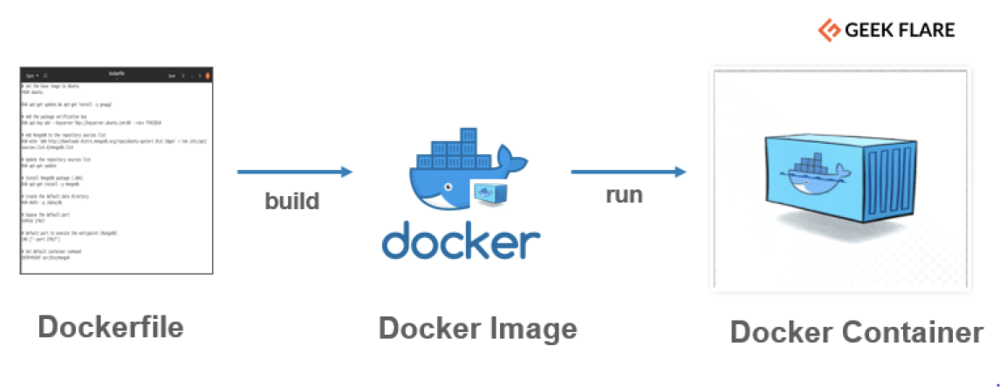
