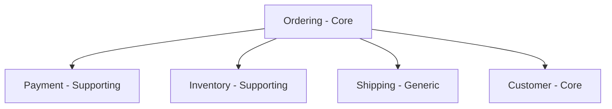

# Architecture Blueprint (โมดูล 28)

## เมื่อไหร่ใช้

ใช้เมื่อผู้ใช้ต้องการ **พิมพ์เขียวสถาปัตยกรรมครบวงจร** ตั้งแต่ต้นจนจบ:

- ออกแบบ **โดเมน** (DDD) → Bounded Context, Aggregate, Ubiquitous Language
- แบ่ง **โมดูล** (Modular) → Loose Coupling, High Cohesion, Public API
- จัด **ชั้น** (Clean Architecture) → Entities → Use Cases → Adapters → Frameworks
- ได้ **Flow + Folder + Dependency Graph + KPI** พร้อมนำไปสร้างจริง
- **Generate โครงสร้างจริง** ด้วย script (Python / Bash / PowerShell)

**รวม 3 Skills:** `16-ddd` + `17-clean-architecture` + `24-modular`

---

## 🎯 Prompt Template หลัก

```
ออกแบบ Architecture Blueprint สำหรับ [ระบบ/ผลิตภัณฑ์]

## บริบท
- ระบบ: [ ]
- โดเมนธุรกิจ: [ ]
- Tech Stack: [ ]
- ขนาดทีม: [ ]
- ข้อจำกัด: [ ]
- แผนขยายใน 2 ปี: [ ]
- Quality Attributes: [performance/security/scalability/maintainability]
- ภาษา: [ไทย / English / ไทย+อังกฤษ]

## ผลลัพธ์ที่ต้องได้ (7 ส่วน)
1. Domain Map (Bounded Contexts)
2. Module Map + Public API
3. Layered Architecture ต่อโมดูล
4. Dependency Graph (ห้าม Cycle)
5. Communication Flow (Sync + Async)
6. Folder Structure (Monorepo)
7. KPI + Checklist

## Optional
8. Roadmap (Modular Monolith → Microservices)
9. Generate folder structure (via scripts)
```

---

## 🧩 ส่วนที่ 1 — Domain Map (DDD)

### Subdomain Classification

| ประเภท | ความหมาย | ตัวอย่าง |
|---|---|---|
| **Core** | จุดแข่งขันหลักของธุรกิจ | Ordering, Pricing |
| **Supporting** | สนับสนุน Core แต่ไม่ใช่จุดแข่ง | Inventory, Shipping |
| **Generic** | มีสำเร็จรูป / ซื้อใช้ได้ | Auth, Notification |

### Bounded Context Template

```
📦 Context: [ชื่อ]
🎯 ประเภท: [Core / Supporting / Generic]
📝 ความรับผิดชอบ: [ ]
🗣️ Ubiquitous Language: [คำศัพท์ 3-7 คำ]
🔗 ความสัมพันธ์กับ Context อื่น:
   - Upstream: [ ]
   - Downstream: [ ]
   - Pattern: [ACL / OHS / Shared Kernel / Customer-Supplier / Conformist]
```

### Domain Artifacts Template

```
Entities:        [ ]
Value Objects:   [ ]
Aggregates:      [Aggregate Root + Entities]
Domain Events:   [ ]
Domain Services: [ ]
Repositories:    [interface เท่านั้น]
```

---

## 🧩 ส่วนที่ 2 — Module Map (Modular)

### กฎการแบ่งโมดูล

> **1 Bounded Context ≈ 1 Module**

### Module Card Template

```
📦 Module: [ชื่อ]
🎯 Bounded Context: [ ]
📝 หน้าที่: [ ]
🔌 Public API (เปิดให้โมดูลอื่น):
   - Commands: [ ]
   - Queries:   [ ]
   - Events:    [ ]
📥 Dependencies (พึ่งโมดูลอื่น):
   - [ ] → [ ] (เหตุผล)
🚫 ห้ามเข้าถึง: [internal/*]
📊 Data Ownership: [ตาราง/collection ที่เป็นเจ้าของ]
```

### Coupling Rules

| ประเภท | อนุญาต | ตัวอย่าง |
|---|---|---|
| **Sync API** | ✅ | Order → Payment (charge) |
| **Async Event** | ✅ | Order → Inventory (reserve) |
| **Shared Kernel** | ⚠️ เฉพาะ primitives | Money, Result, Guard |
| **Direct Import** | ❌ | ห้าม import internal ของโมดูลอื่น |
| **Shared DB** | ❌ | ห้ามใช้ตารางร่วม (นอกจาก read model) |

---

## 🧩 ส่วนที่ 3 — Layered Architecture (Clean Arch)

### 4 Layers

```
┌──────────────────────────────────────┐
│ 4. presentation  (HTTP / CLI / UI)   │  ← Framework
├──────────────────────────────────────┤
│ 3. infrastructure (DB / API / Msg)   │  ← Adapter
├──────────────────────────────────────┤
│ 2. application   (Use Cases)         │  ← Orchestration
├──────────────────────────────────────┤
│ 1. domain        (Entities / VO)     │  ← Pure
└──────────────────────────────────────┘
        ⬇️ Dependency ชี้เข้าด้านในเท่านั้น
```

### Dependency Rule

- ✅ presentation → application → domain
- ✅ infrastructure → domain (implements interface)
- ❌ domain → ห้ามพึ่ง framework, DB, HTTP
- ❌ ห้ามมี cycle ระหว่าง layer

### Layer Template ต่อโมดูล

```
[module]/
├── domain/          # Entities, VO, Aggregates, Events, Repos (interface)
├── application/     # Use Cases, DTOs, Ports
├── infrastructure/  # Persistence, Messaging, External adapters
├── presentation/    # Controllers, Routes, CLI
├── public/          # ⚠️ เท่านั้นที่โมดูลอื่น import ได้
└── tests/           # unit / integration / e2e
```

---

## 🧩 ส่วนที่ 4 — Dependency Graph

### กฎ

1. ❌ **ห้าม Cycle**
2. ✅ ทิศทางชัดเจน (A → B ≠ B → A)
3. ✅ Layer ล่างห้ามพึ่ง Layer บน
4. ✅ ข้ามโมดูลผ่าน `public/` เท่านั้น

### ตัวอย่าง Graph



### การตรวจสอบ

```bash
# Node.js
npx depcruise --validate .dependency-cruiser.js src/

# Python (custom script)
python scripts/check_deps.py
```

---

## 🧩 ส่วนที่ 5 — Communication Flow

### Sync (Request/Response)

```
Client → API Gateway → Module A
                          │
                          └─(sync call)→ Module B → response
```

**ใช้เมื่อ:** ต้องการผลทันที, transaction เดียวกัน, query

### Async (Event-Driven)

```
Module A ──publish──▶ Event Bus ──▶ Module B (subscribe)
                                 └─▶ Module C (subscribe)
```

**ใช้เมื่อ:** ไม่ต้องรอ, eventual consistency, fan-out

### Flow Template

```
Trigger:   [HTTP / CLI / Cron / Event]
Flow:
  1. [Module A] รับ request
  2. [Module A] validate + business rule
  3. [Module A] → (sync) [Module B]: [action]
  4. [Module A] publish event: [EventName]
  5. [Module C] subscribe → [action]
Result:
  - Immediate: [ ]
  - Eventual:  [ ]
```

---

## 🧩 ส่วนที่ 6 — Folder Structure (Monorepo)

```text
project-root/
├── docs/
│   ├── domain-map.md
│   ├── dependency-graph.md
│   ├── ubiquitous-language.md
│   └── adr/
├── src/
│   ├── shared/
│   │   ├── kernel/
│   │   ├── contracts/
│   │   └── infra/
│   ├── modules/
│   │   ├── [module-a]/
│   │   │   ├── README.md
│   │   │   ├── domain/
│   │   │   ├── application/
│   │   │   ├── infrastructure/
│   │   │   ├── presentation/
│   │   │   ├── public/
│   │   │   └── tests/
│   │   ├── [module-b]/
│   │   └── [module-c]/
│   └── apps/
│       ├── api/
│       ├── worker/
│       └── web/
├── libs/
├── scripts/
│   ├── gen_module.py          ⭐ Primary (cross-platform)
│   ├── gen-module.sh          (macOS/Linux)
│   ├── gen-module.ps1         (Windows PowerShell)
│   ├── gen-module.bat         (Windows CMD)
│   ├── check_deps.py
│   └── check-boundaries.ts
└── tests/
    ├── contract/
    └── e2e/
```

### Folder Rule

| Rule | คำอธิบาย |
|---|---|
| 1 Module = 1 Folder | ทุกโมดูลอยู่ที่ `src/modules/[name]/` |
| 4 Layers | `domain / application / infrastructure / presentation` |
| 1 Public API | `public/index.ts` เท่านั้นที่เปิด |
| Tests อยู่ข้างใน | `tests/` ต่อโมดูล |
| Docs แยกออก | `docs/` ที่ root |

---

## 🧩 ส่วนที่ 7 — KPI + Checklist

### KPI วัดคุณภาพ

| หมวด | KPI | เป้าหมาย |
|---|---|---|
| **Modular** | Coupling Score | ↓ |
| | Cohesion Score | ↑ |
| | Cycle Count | **0** |
| | Change Impact Radius | ≤ 5 files |
| | Module Reuse Rate | ↑ |
| **DDD** | Ubiquitous Language Coverage | ≥ 90% |
| | Aggregate Size | ≤ 5 entities |
| | Bounded Context Count | 3–7 |
| **Clean Arch** | Dependency Rule Violations | **0** |
| | Domain Test Coverage | ≥ 90% |
| | Framework Coupling (domain) | **0** |
| **Communication** | Public API Coverage | **100%** |
| | Event Schema Versioned | **100%** |
| **Overall** | Time to onboard new dev | ≤ 1 สัปดาห์ |
| | Build time per module | ≤ 30 วินาที |
| | Deployment independence | ≥ 80% |

### Checklist หลังออกแบบ

**DDD:**
- [ ] ระบุ Core / Supporting / Generic subdomain
- [ ] มี Bounded Context + Ubiquitous Language
- [ ] Aggregate Root ชัดเจน, ≤ 5 entities
- [ ] Domain Events ระบุชัด

**Modular:**
- [ ] 1 Bounded Context = 1 Module
- [ ] Public API เปิดเฉพาะที่จำเป็น
- [ ] ไม่มี Dependency Cycle
- [ ] Data Ownership ชัดเจน

**Clean Arch:**
- [ ] แยก 4 layer ครบ
- [ ] Domain ไม่พึ่ง framework
- [ ] Repository = interface ใน domain
- [ ] Dependency ชี้เข้าด้านในเท่านั้น

**Communication:**
- [ ] Sync / Async ระบุชัด
- [ ] Event schema มี version
- [ ] ไม่มี distributed transaction (ใช้ Saga ถ้าจำเป็น)

---

## 🛠️ Folder Generator (3 Platforms)

เลือกใช้ตาม OS — แนะนำ **Python** เพราะใช้ได้ทุกแพลตฟอร์ม

| Script | Platform | แนะนำเมื่อ |
|---|---|---|
| `gen_module.py` ⭐ | Windows / macOS / Linux | ใช้เป็นหลัก (cross-platform) |
| `gen-module.sh` | macOS / Linux | เครื่องมี bash อยู่แล้ว |
| `gen-module.ps1` | Windows PowerShell | ต้องการ auto-open Explorer |
| `gen-module.bat` | Windows CMD | Double-click / legacy |

---

### 🐍 1) Python — `scripts/gen_module.py` (แนะนำ)

**Requirements:** Python 3.9+ (ใช้แค่ standard library)

#### วิธีใช้

```bash
cd scripts/

# พื้นฐาน
python gen_module.py ordering

# ระบุ Bounded Context + Type
python gen_module.py payment --type Core --context "Payment Processing"

# ระบุ base path
python gen_module.py inventory --base-path ./src/modules

# Dry-run (ดูตัวอย่างก่อนสร้าง)
python gen_module.py ordering --dry-run

# ดู template ทั้งหมด
python gen_module.py --list-templates

# เขียนทับ
python gen_module.py ordering --force
```

#### Flags

| Flag | ย่อ | คำอธิบาย |
|---|---|---|
| `--base-path` | `-b` | Path หลัก (default: `./src/modules`) |
| `--context` | `-c` | Bounded Context (default: = ชื่อโมดูล) |
| `--type` | `-t` | `Core` / `Supporting` / `Generic` |
| `--force` | `-f` | เขียนทับถ้ามีอยู่ |
| `--dry-run` | `-n` | แสดงโดยไม่สร้างจริง |
| `--no-color` | | ปิดสี |
| `--list-templates` | | แสดง LAYERS ทั้งหมด |

#### Alias

```bash
# macOS / Linux (~/.bashrc หรือ ~/.zshrc)
alias nm='python3 /path/to/skills/28-architecture-blueprint/scripts/gen_module.py'
```

```powershell
# Windows PowerShell ($PROFILE)
function New-AppModule {
    param(
        [Parameter(Mandatory, Position=0)][string]$Name,
        [Parameter(Position=1)][ValidateSet('Core','Supporting','Generic')][string]$Type = 'Supporting'
    )
    python "C:\path\to\skills\28-architecture-blueprint\scripts\gen_module.py" $Name --type $Type
}
Set-Alias nm New-AppModule
```

ใช้: `nm ordering Core`

---

### 🐧 2) Bash — `scripts/gen-module.sh`

**Requirements:** bash (macOS / Linux)

```bash
chmod +x gen-module.sh
./gen-module.sh ordering
```

---

### 🪟 3) PowerShell — `scripts/gen-module.ps1`

**Requirements:** Windows PowerShell 5.1+ / PowerShell 7+

```powershell
Set-ExecutionPolicy -Scope Process -ExecutionPolicy Bypass

.\gen-module.ps1 ordering
.\gen-module.ps1 payment -ContextType Core -BoundedContext "Payment Processing"
.\gen-module.ps1 inventory -BasePath "C:\Projects\MyApp\src\modules" -Force
```

**Feature พิเศษ:**
- ✅ Auto-open File Explorer หลังสร้างเสร็จ
- ✅ Validate ชื่อโมดูล (kebab-case)
- ✅ เขียนไฟล์ UTF-8 ไม่มี BOM

#### Wrapper `gen-module.bat`

```bat
@echo off
powershell.exe -NoProfile -ExecutionPolicy Bypass -File "%~dp0gen-module.ps1" %*
```

ใช้: `gen-module.bat ordering Core`

---

### 📊 เปรียบเทียบ 3 Scripts

| Feature | `.py` ⭐ | `.sh` | `.ps1` |
|---|---|---|---|
| Windows | ✅ | ❌ | ✅ |
| macOS / Linux | ✅ | ✅ | ❌ |
| ไม่ต้องตั้ง ExecutionPolicy | ✅ | ✅ | ❌ |
| ไม่ต้องลง library | ✅ | ✅ | ✅ |
| `--dry-run` | ✅ | ❌ | ❌ |
| `--list-templates` | ✅ | ❌ | ❌ |
| `--no-color` | ✅ | ❌ | ❌ |
| `--force` | ✅ | ❌ | ✅ |
| Auto-open folder | ❌ | ❌ | ✅ |
| Validate ชื่อโมดูล | ✅ | ❌ | ✅ |
| UTF-8 ไม่มี BOM | ✅ | ✅ | ✅ |

**คำแนะนำ:**
- 🥇 ใช้ **`gen_module.py`** เป็นหลัก → cross-platform + feature ครบ
- 🥈 เพิ่ม `.sh` / `.ps1` เป็น wrapper สำหรับ convenience

---

## 📋 ตัวอย่างการเรียกใช้

### ตัวอย่างที่ 1 — E-commerce (ออกแบบครบ)

```
ใช้ skill 28-architecture-blueprint
ระบบ: E-commerce Platform
โดเมน: Ordering, Payment, Inventory, Shipping, Customer
Tech Stack: Node.js + TypeScript + PostgreSQL + Kafka
ขนาดทีม: 5 ทีม
แผนขยาย: Microservices ใน 2 ปี
ภาษา: ไทย+อังกฤษ
```

### ตัวอย่างที่ 2 — SaaS B2B

```
ใช้ skill 28-architecture-blueprint
ระบบ: B2B SaaS — Project Management
โดเมน: Workspace, Project, Task, Billing, Auth
Tech Stack: Go + PostgreSQL + gRPC
Quality Attributes: multi-tenant, audit log, SSO
ภาษา: English
```

### ตัวอย่างที่ 3 — Mobile backend

```
ใช้ skill 28-architecture-blueprint
ระบบ: Mobile App Backend (Clinic Booking)
โดเมน: Clinic, Doctor, Appointment, Patient, Notification
Tech Stack: NestJS + MongoDB + Redis + RabbitMQ
ขนาดทีม: 3 ทีม
ภาษา: ไทย
```

### ตัวอย่างที่ 4 — Generate folder จริง

```bash
# หลังได้ Blueprint แล้ว → generate จริง
cd scripts/
python gen_module.py ordering --type Core
python gen_module.py payment --type Supporting
python gen_module.py inventory --type Supporting

# ตรวจสอบ
python gen_module.py --list-templates
```

---

## 📤 Output Format (Markdown)

ผลลัพธ์ที่ Skill จะสร้าง:

```markdown
# Architecture Blueprint: [ชื่อระบบ]

## 1. Domain Map
   - Subdomain Classification
   - Bounded Context Cards
   - Context Map (ACL / OHS / Shared Kernel)

## 2. Module Map
   - Module Cards (Public API + Dependencies)
   - Coupling Rules
   - Data Ownership

## 3. Layered Architecture
   - 4 Layers per Module
   - Dependency Rule

## 4. Dependency Graph
   - Diagram (Mermaid)
   - Cycle Check

## 5. Communication Flow
   - Sync Flow
   - Async Flow (Event Bus)
   - Saga (ถ้ามี)

## 6. Folder Structure
   - Monorepo Tree
   - Generator Script + ตัวอย่างคำสั่ง

## 7. KPI + Checklist
   - Quality Metrics
   - Checklist 4 หมวด

## 8. Roadmap (Optional)
   - Phase 1: Modular Monolith
   - Phase 2: Extract Services
   - Phase 3: Full Microservices
```

---

## ⚠️ ข้อกำหนด

- ใช้ **Ubiquitous Language** เดียวกันทั้งโปรเจกต์
- **ห้ามสมมติ** ข้อมูลที่ไม่มี → ถามผู้ใช้เพิ่ม
- ถ้า Tech Stack ไม่ชัด → แนะนำ 2–3 ตัวเลือก
- ถ้าทีมเล็ก (< 5 คน) → แนะนำ Modular Monolith ก่อน
- ถ้าต้องการ Microservices → ระบุเกณฑ์แยก (team size, scaling, deploy)
- ใช้ **Mermaid** สำหรับ diagram
- หลังได้ Blueprint → **เสนอ generate folder** ด้วย script ที่เหมาะสม
- จบด้วย **สรุป 5 บรรทัด**

---

## 🔗 Skill ที่ใช้ร่วมกันบ่อย

| คู่ Skill | ใช้เมื่อ |
|---|---|
| `28 + 12` | Blueprint → Software Architecture เจาะลึก |
| `28 + 15` | Blueprint → Microservices Design |
| `28 + 18` | Blueprint → Risk Management |
| `28 + 19` | Blueprint → POC Plan |
| `28 + 25` | Blueprint → UX/UI ของแต่ละโมดูล |
| `28 + 27` | Blueprint → Agile Ceremonies ของทีม |
| `16 + 17 + 24` | แยกดูทีละเรื่อง |

---

## 📁 โครงสร้างไฟล์ของ Skill นี้

```text
28-architecture-blueprint/
├── SKILL.md                          ⬅️ ไฟล์นี้
├── templates/
│   ├── folder-tree.txt
│   ├── module-readme.template.md
│   └── public-api.template.ts
└── scripts/
    ├── gen_module.py                 ⭐ Primary (cross-platform)
    ├── gen-module.sh                 (macOS / Linux)
    ├── gen-module.ps1                (Windows PowerShell)
    ├── gen-module.bat                (Windows CMD wrapper)
    └── check_deps.py                 (Optional)
```

---

## ✅ สรุป 5 บรรทัด

1. **28-architecture-blueprint** = Skill รวม DDD + Clean Arch + Modular
2. **7 ส่วน:** Domain → Module → Layer → Dependency → Communication → Folder → KPI
3. **Folder Generator:** Python ⭐ / Bash / PowerShell (cross-platform)
4. **Output:** Blueprint ครบ + Generate folder จริงได้ + Checklist + KPI
5. **ใช้เมื่อ:** เริ่มโปรเจกต์ใหม่ หรือ refactor ระบบเดิมเป็น Modular